<p align="center">
  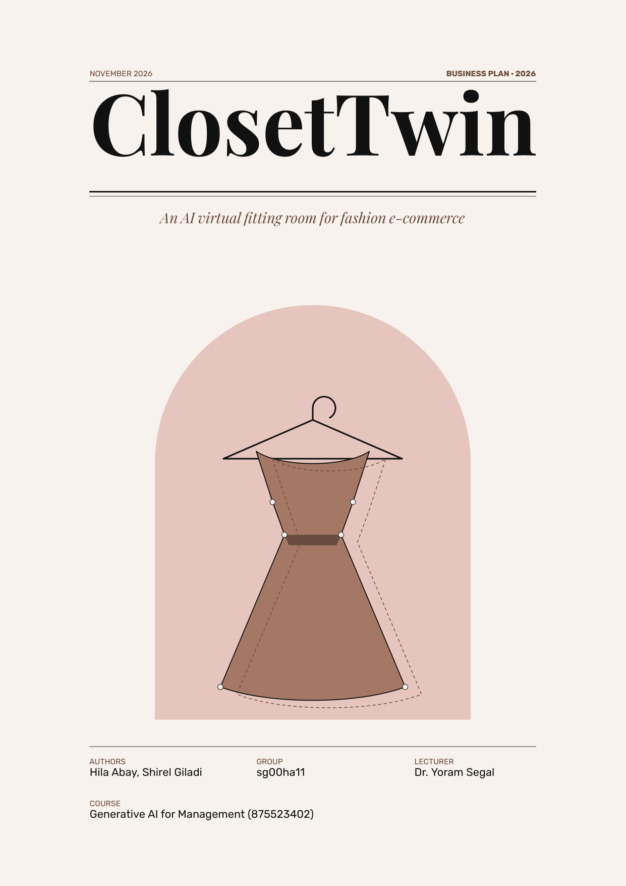
</p>

# ClosetTwin: an AI-driven fitting room for fashion e-commerce

*A Hebrew/English (RTL + LTR) business-plan report for **Generative AI for Management**, written and typeset by a team of five Claude Code agents with a human in the loop.*

**Read it:** [`main.pdf`](main.pdf) (46 pages) · **What we promised:** [`PRD.md`](PRD.md) · **How and in what order:** [`PLAN.md`](PLAN.md) · **Who does what:** [`TODO.md`](TODO.md) · **How we talked to the agents:** [`prompts/`](prompts/)

---

## 1. The report at a glance

ClosetTwin sells online fashion retailers a size-recommendation tool built on a phone body scan. The plan argues that returns caused by poor fit are a cost large enough for retailers to pay a few cents per order, tests that argument with a break-even formula and a pilot design, and ends with an honest funding ask: about **$3.9M** to reach year 5, with no profit inside the five-year model.

| | |
|---|---|
| **Length** | 46 pages including the cover and front matter (the body is 39 numbered pages): cover, one-page Hebrew executive summary, contents and lists (front matter), 10 chapters, references (IEEE), Appendix A (the chart's Python code) |
| **Chapters** | 1 Introduction and Problem · 2 Market: TAM, SAM and SOM · 3 Competition · 4 Product and Technology · 5 Business Model and Pricing · 6 Go-to-Market · 7 Operations, Team and Roadmap · 8 Financial Plan · 9 Risks · 10 Conclusion |
| **Figures** | 7 (market nesting, positioning map, data flow, roadmap, 5-year projection, retailer economics, risk matrix); every number comes from `python/model.py` |
| **Sources** | 29 verified entries in [`references.bib`](references.bib) |
| **Languages** | English body; the Hebrew summary is typeset right-to-left, with Latin names and numbers kept left-to-right |

<p align="center">
  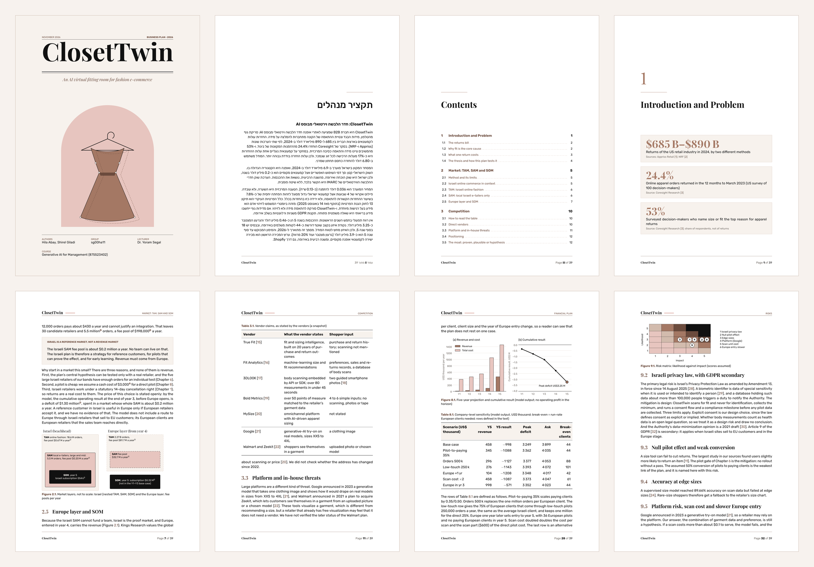
</p>

| Contents | Hebrew summary | Chapter 1 |
|---|---|---|
| 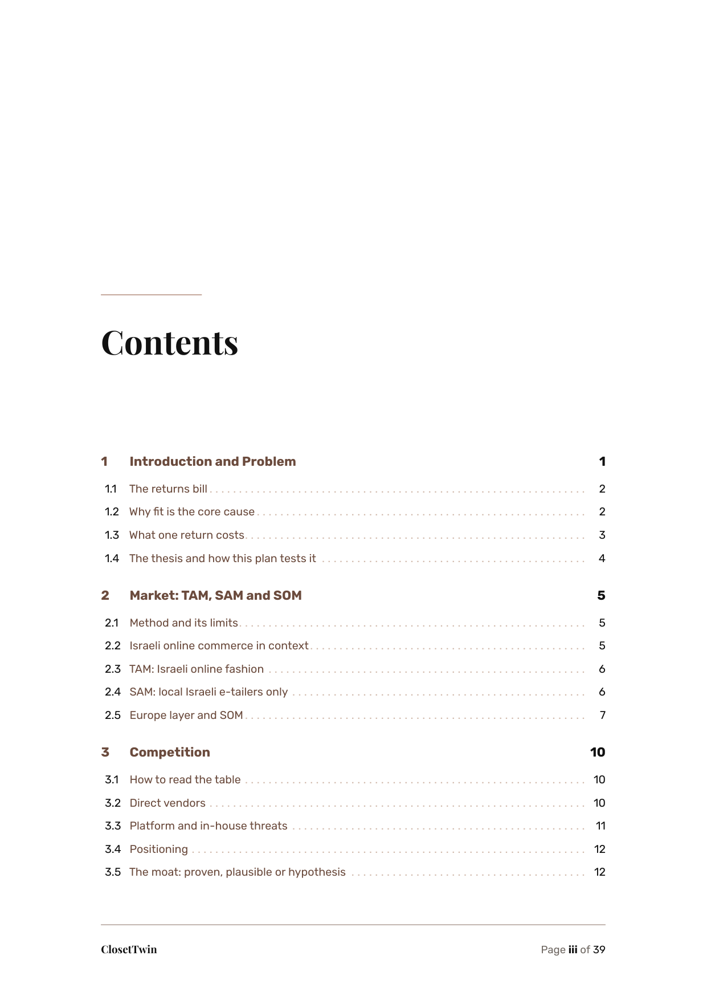 | 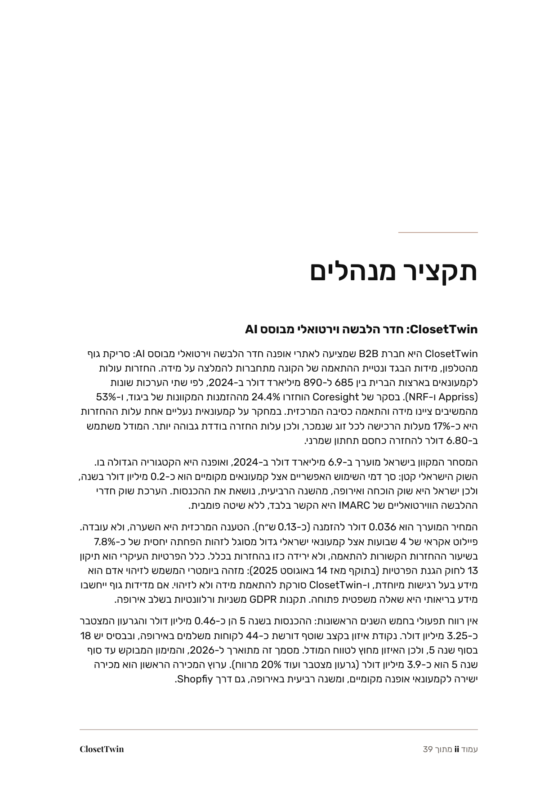 | 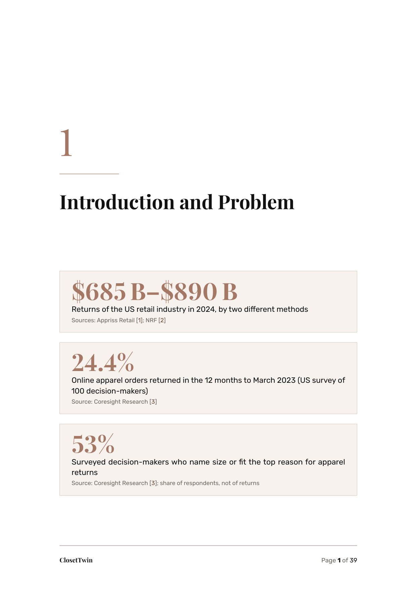 |

| Figure 8.1 and Table 8.1 | Risk matrix | Code appendix |
|---|---|---|
| 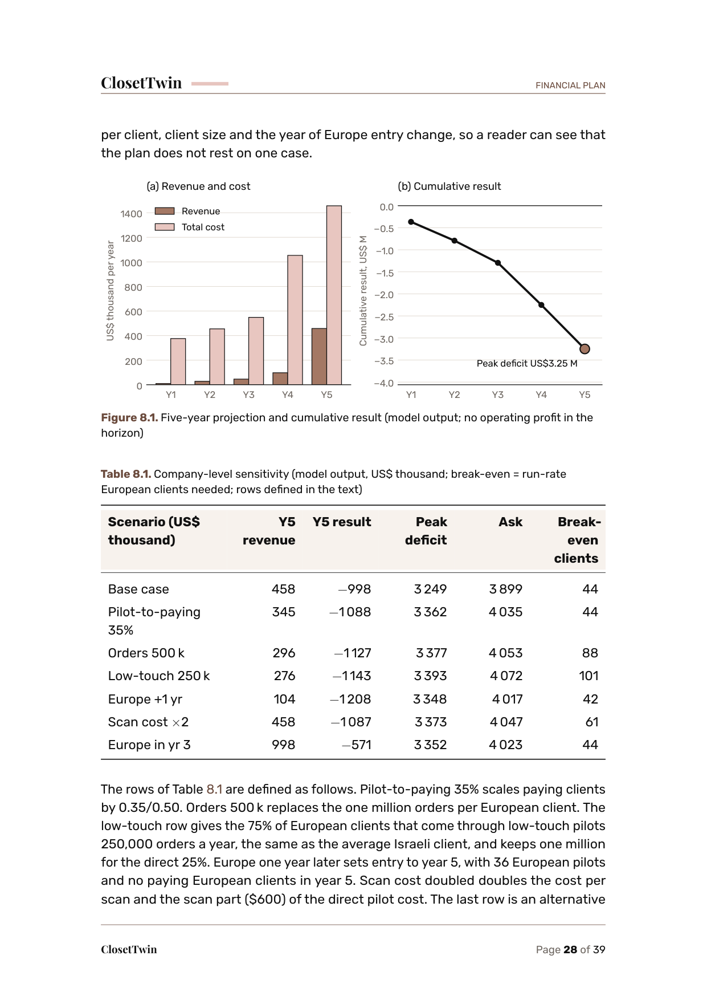 | 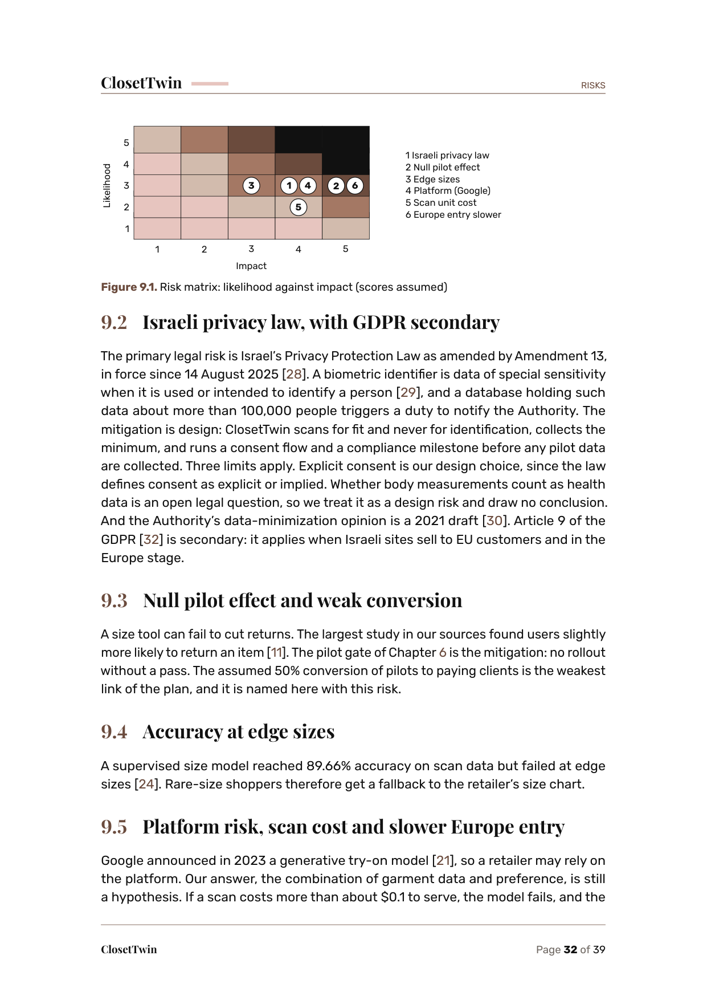 | 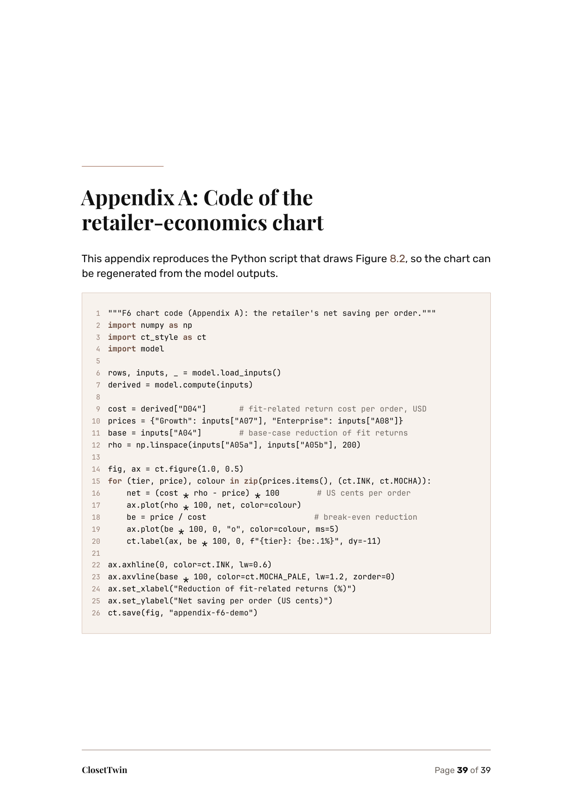 |

---

## 2. The agent team

Five Claude Code sessions, each in its own window and its own folder. Only the owner of a file edits it; everyone else sends a `REQUEST`. Only `master-se` commits.

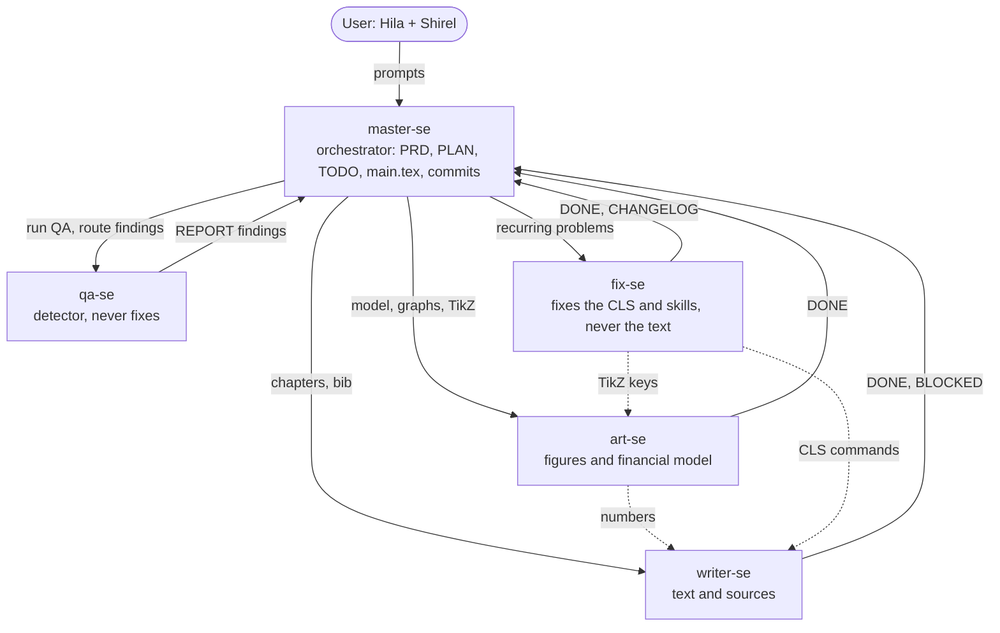

| Agent | Folder | Role | Model |
|---|---|---|---|
| **master-se** | `/` | Plans, assigns, reviews, builds, integrates, commits | Opus 5.5 and Sonnet 5.5 |
| **writer-se** | `writer/` | Chapters, bibliography, claim-trace | Sonnet 5.5 |
| **art-se** | `art/` | Financial model, Python graphs, TikZ figures | Sonnet 5.5 |
| **qa-se** | `qa/` | Detector: runs the QA skills, writes reports | Sonnet 5.5 |
| **fix-se** | `fix/` | Owner of `closettwin.cls`, fonts and skills | Sonnet 5.5 |

*Models are as recorded in the session transcripts. Resource management: the high-volume work (drafting, scripts, class code, QA runs) ran on the cheaper Sonnet model; the stronger Opus model was kept for planning and orchestration and for the independent content red team, which must not be one of the writers.*

| Mesh check: every agent can reach every other | The team at work |
|---|---|
| 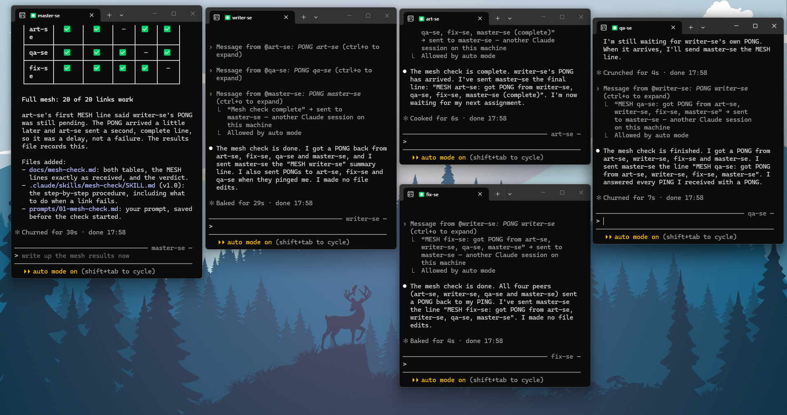 | 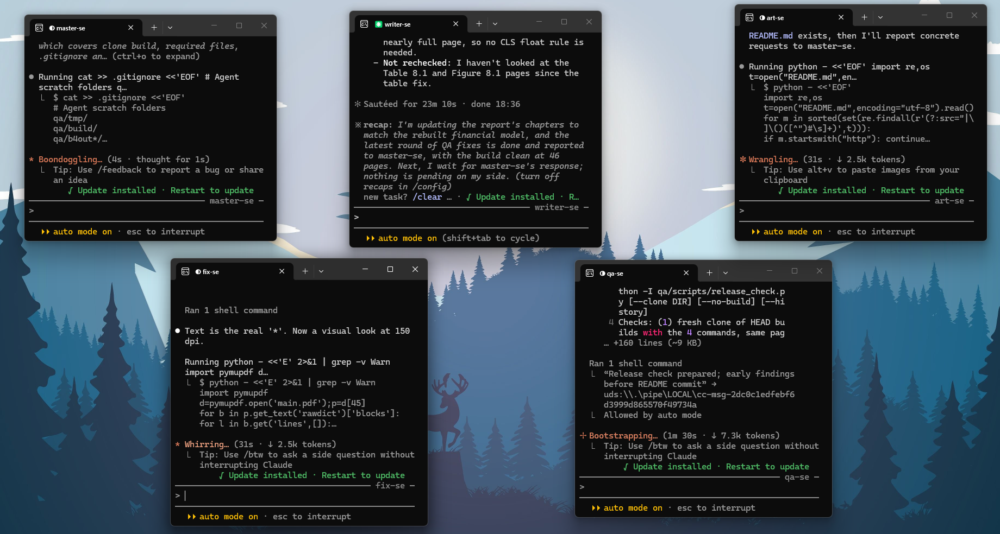 |

---

## 3. How we worked

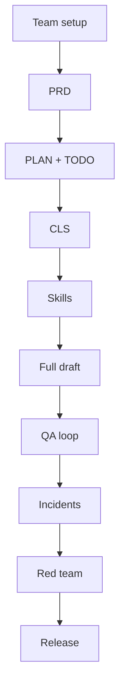

| Stage | What happened | Prompt |
|---|---|---|
| Team setup | Five agents, folders, roles, the rule file `CLAUDE.md` | [00](prompts/00-team-setup.md) |
| Mesh check | A full PING/PONG test: 20 of 20 links work | [01](prompts/01-mesh-check.md) |
| Documentation system | PRD, PLAN, TODO; every prompt logged by a hook | [02](prompts/02-documentation-system.md) |
| Expert committee | Experts and a red team attack the PRD (32 findings) | [03](prompts/03-expert-committee.md) |
| CLS template | The LuaLaTeX class `closettwin.cls`, built in six stages | [04](prompts/04-cls-template.md) |
| Skills and full draft | 14 skills; chapters 1-10, Hebrew summary, 7 figures | [05](prompts/05-skills-and-full-draft.md) |
| QA, incidents, red team | Defects the user found became incidents with root causes; full QA; content red team; model rebuild | [06](prompts/06-qa-incidents-redteam.md) |
| README and release | This page, screenshots, release check | [07](prompts/07-readme-and-release.md) |

The **iron rule** behind all of it: a problem that can recur (spacing, direction, fonts, captions, table look, numbering, citations) is fixed once, in the class or in a skill, with a version bump and a CHANGELOG row. It is never patched by hand in a chapter.

---

## 4. Design system

* **Fonts (all OFL, in [`fonts/`](fonts/), hashes in `fonts/SOURCES.md`):** Playfair Display for English headings, Rubik for body text and all Hebrew, JetBrains Mono for the code box only, Latin Modern Math for formulas.
* **Palette:** ivory, ink, mocha, powder pink and their deep/muted variants; contrast is checked by a script.
* **Components:** magazine cover (TikZ), chapter opener, stat card, pull quote, insight box, assumption/derived/sourced tags (`D`, `A`), booktabs tables, captioned figures, code box that reads the real Python file, Hebrew page with RTL lists.
* **Class:** [`closettwin.cls`](closettwin.cls), currently **v0.24**. Every version, its problem, root cause and reporter: [`fix/CHANGELOG.md`](fix/CHANGELOG.md). Every command with an example: [`docs/cls-commands.md`](docs/cls-commands.md).

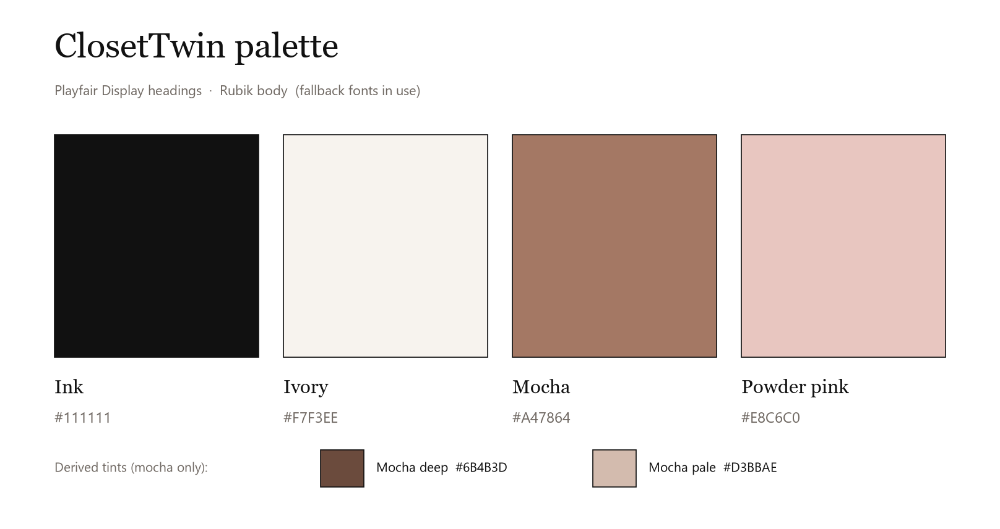

---

## 5. Skills

All in [`.claude/skills/`](.claude/skills/), versioned, owned by fix-se.

| Skill | Purpose |
|---|---|
| [`writer`](.claude/skills/writer/SKILL.md) | Chapter writing: continuous prose, every claim cited, every money figure from the model |
| [`illustrator`](.claude/skills/illustrator/SKILL.md) | Figures: palette, readable text, data from the model, captions |
| [`qa-super`](.claude/skills/qa-super/SKILL.md) | Orchestrates the whole QA pass and merges the reports |
| [`qa-BiDi`](.claude/skills/qa-BiDi/SKILL.md) | Hebrew/English direction: reversed runs, bullets, punctuation |
| [`qa-table`](.claude/skills/qa-table/SKILL.md) | Tables: caption, width, number alignment, sums |
| [`qa-img`](.claude/skills/qa-img/SKILL.md) | Figures: caption, size, fonts, palette, contrast, overlaps |
| [`qa-code`](.claude/skills/qa-code/SKILL.md) | Code appendix: matches the real file, fonts, margins |
| [`qa-typeset`](.claude/skills/qa-typeset/SKILL.md) | Log and pagination: overfull boxes, undefined references, page budget |
| [`qa-infra`](.claude/skills/qa-infra/SKILL.md) | Repository structure, reproducibility, no IDs in the repo |
| [`qa-cls-version`](.claude/skills/qa-cls-version/SKILL.md) | Version discipline: class, build log and CHANGELOG agree |
| [`qa-fixer`](.claude/skills/qa-fixer/SKILL.md) | Turns QA findings into fixes at the right level (class vs. one text) |
| [`incident`](.claude/skills/incident/SKILL.md) | Post-mortem: root cause, why no detector caught it, the new check |
| [`red-team`](.claude/skills/red-team/SKILL.md) | Adversarial review of the plan by an independent reviewer |
| [`mesh-check`](.claude/skills/mesh-check/SKILL.md) | Tests that every agent can message every other |

---

## 6. Quality

### Incidents
Twelve defects escaped to a build; each has an investigation in [`incidents/`](incidents/) and a new check in the matching QA skill.

| # | Defect | Root cause (one line) |
|---|---|---|
| [01](incidents/01-literal-double-hyphen-in-statcard.md) | `--` printed literally in key numbers | Heading font declared without TeX ligatures |
| [02](incidents/02-toc-chapter-numbers-in-margin.md) | Numbers 1, 2, 3 in the margin of the Hebrew page and contents | Contents label hung outside the left margin |
| [03](incidents/03-lot-leaks-internal-text.md) | Internal text in the List of Tables | A caption without short form copies everything into the list |
| [04](incidents/04-narrow-justified-table-columns.md) | Table 8.1 narrow, stretched spaces | Justified `X` columns plus long `l` columns |
| [05](incidents/05-code-box-leaves-3-lines-alone.md) | Code box left 3 lines alone | Breakable at any line, no minimum fragment |
| [06](incidents/06-numbers-in-math-font.md) | `6.03%` in the maths font | Digits in `$...$` are maths characters |
| [07](incidents/07-legend-after-first-use.md) | D/A tag legend after its first use | Legend was a manual call |
| [08](incidents/08-gap-after-table-reference.md) | 40% of a page empty | A tall float with nothing after it to fill the gap |
| [09](incidents/09-cover-missing-course-number.md) | Course number missing on the cover | One-off content omission |
| [10](incidents/10-contents-title-offset.md) | "Contents" title not aligned with the rule | Paragraph indent inside the opener block |
| [11](incidents/11-tall-table-alone-and-appendix-opener.md) | Appendix and Table 9.1 alone on a page | "Never split" and "no page alone" contradicted each other |
| [12](incidents/12-appendix-label-column-list-entries.md) | Appendix opener, wide label column, long list entries | Opener too big for an appendix; no helper for a label column |

### Red team on the content
An independent reviewer (Opus, not one of the writers) listed the ten weakest points. Full log: [`docs/red-team-review.md`](docs/red-team-review.md).

| # | Weak point | Decision |
|---|---|---|
| 1 | Year-5 revenue rests on one chain of assumptions | Adopted: disclosed; half-year billing in the model; company sensitivity table |
| 2 | 17% is per pair sold, not per return | Adopted: reworded; $6.80 kept as a conservative lower bound, implied $24.29 shown |
| 3 | 15% shop-wide effect is not "modest" at 25% scan uptake | Adopted |
| 4 | "Year-6 break-even" is an extrapolation | Adopted: claim removed; ask funds through year 5; tranches tied to the pilot |
| 5 | Pilot design cannot test mid-size retailers | Adopted: pooled evidence and longer pilots |
| 6 | 50% pilot-to-paying has no source | Adopted: labelled; 35% sensitivity row |
| 7 | Knesset report used selectively | Adopted: 2024 shares added |
| 8 | Israel first costs more than its market is worth | Adopted, modified: Israel stays the first market, argued as a reference market |
| 9 | Cost base incomplete (marketing, cloud, legal) | Adopted: three cost lines added; ask rose from $2.8M to $3.9M |
| 10 | Hebrew summary contradicted the English | Adopted |

### QA reports
All reports are in [`qa/reports/`](qa/reports/); the last one, [`06-final-qa-super.md`](qa/reports/06-final-qa-super.md), found no blockers. Acceptance criteria: [`qa/acceptance-criteria.md`](qa/acceptance-criteria.md).

---

## 7. Our dialogue with the agents

Everything the user typed, and what came back, is kept in three levels:

* [`prompts/MY-DIALOGUE-WITH-THE-AGENTS.md`](prompts/MY-DIALOGUE-WITH-THE-AGENTS.md): one readable file for the lecturer: every message, in time order, with date, time, agent and a short summary of the answer.
* [`prompts/log/`](prompts/log/): the automatic log of every prompt, one file per day (written by a hook).
* [`prompts/sessions/`](prompts/sessions/): the exported session transcripts (tool output omitted).
* The curated prompts, word for word: [`prompts/00-…` to `07-…`](prompts/).

---

## 8. Build it yourself

**Requirements:** MiKTeX with LuaLaTeX, biber and biblatex; Python 3 with matplotlib (figures) and PyMuPDF (page renders). Fonts are in `fonts/`; the packages are listed in [`docs/template-README.md`](docs/template-README.md).

From the project root, always this order (the class loads fonts by relative path):

```
lualatex --disable-installer main
biber main
lualatex --disable-installer main
lualatex --disable-installer main
```

`--disable-installer` turns a missing MiKTeX package into an error instead of a hanging prompt. A build is clean when it ends with no errors, no undefined references or citations, and no overfull boxes over 1 pt. Figures: `python python/model.py` and the `fig_*.py` scripts write to `figures/`.

```
.
├── main.tex, main.pdf         the report
├── chapters/                  00-summary-he, 01 … 10
├── closettwin.cls, fonts/     the class and its OFL fonts
├── references.bib             29 IEEE sources
├── python/                    financial model, graph scripts, data/assumptions.csv
├── figures/                   figure PDFs and TikZ figures
├── .claude/skills/            14 skills
├── incidents/, qa/, fix/      investigations, QA reports, class history
├── prompts/                   curated prompts, log, sessions, the dialogue file
├── docs/                      class docs, red-team review, screenshots
├── PRD.md, PLAN.md, TODO.md   requirements, plan, task list
└── writer/, art/              agent notes (not part of the deliverable)
```

---

## 9. Authors

**Hila Abay** and **Shirel Giladi** · group **sg00ha11** · course *Generative AI for Management* (875523402) · lecturer **Dr. Yoram Segal**.
